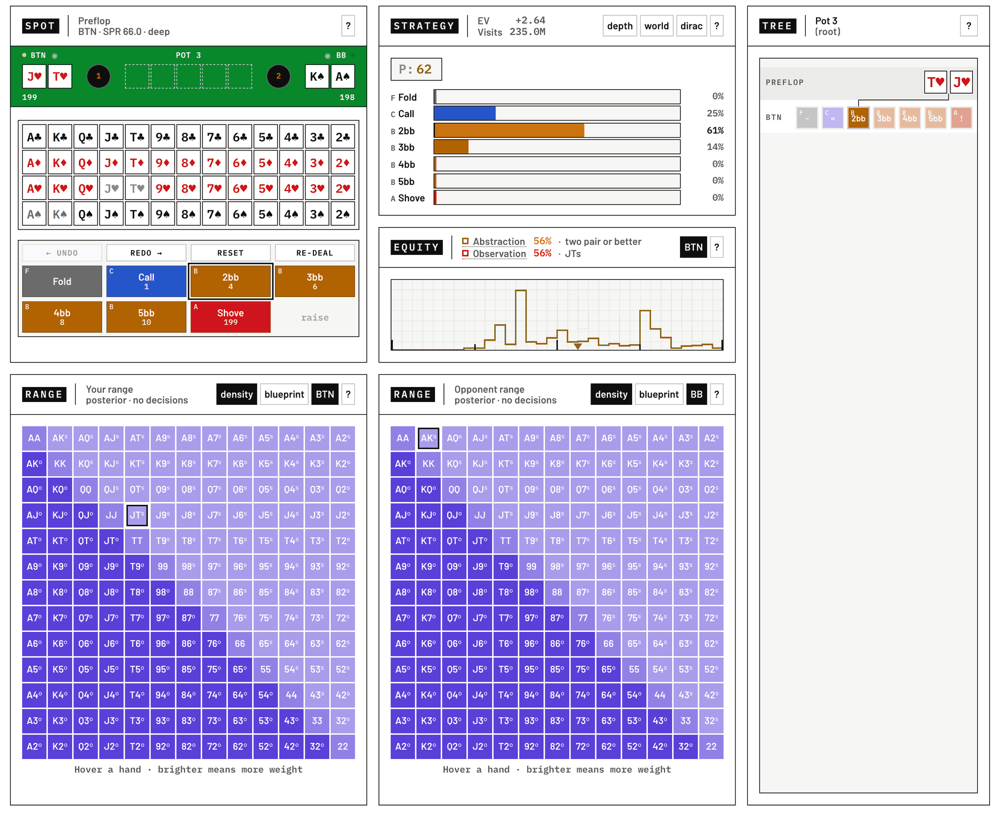
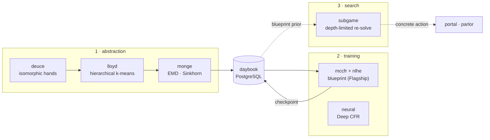
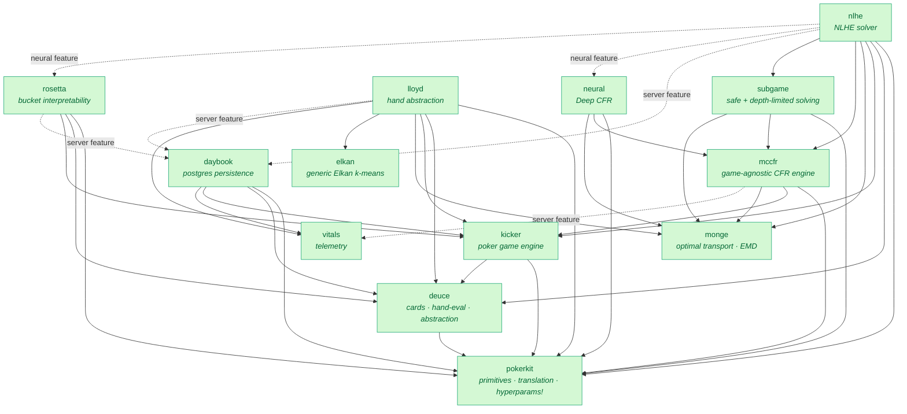

# robopoker

[](LICENSE)
[](https://github.com/krukah/robopoker/actions/workflows/ci.yml)
[](https://crates.io/crates/robopoker)
[](https://docs.rs/robopoker)

A Rust implementation of superhuman-scale poker AI, seeking functional parity with Pluribus¹ — hand evaluation, optimal transport, clustering, the CFR framework, the game engine, persistence, and telemetry, each written from scratch as a single-purpose crate.

<p align="center">
  <picture>
    <source media="(prefers-color-scheme: dark)" srcset="assets/reel/hero-dark.gif"/>
    
  </picture>
  <br/>
  <sub><b>Figure 1.</b> The analysis dashboard (closed-source, built on this repo's public APIs) plays a 3-bet pot on a monotone flop with both hands face up, through a river shove into a fold. Played forward, the ranges show each seat's posterior density narrowing to a handful of holdings; rewound, they show the blueprint's policy per holding.</sub>
</p>

## Contributions

| Contribution | What it is |
| :--- | :--- |
| **Fastest open-source hand evaluator** | Nanosecond evaluation, outperforming Cactus Kev |
| **Optimal transport from scratch** | Sinkhorn⁵ over generic `Density`/`Support` measures |
| **Game-agnostic CFR framework** | Pluggable regret/policy/sampling, held to closed-form equilibria on Kuhn, Leduc, RPS |
| **Action translation⁷,⁸** | Pseudo-harmonic mapping over finite lattices |
| **Deep CFR¹³** | Networks in place of the regret and strategy tables, under the tabular Kuhn and RPS equilibrium tests, trainable in a browser |
| **AIVAT variance reduction** | Low-variance evaluation over hand histories |
| **Chip-exact hand-history replay** | The 10,000 published Pluribus hands, replayed and scored decision by decision |
| **A name for every bucket** | Each abstraction bucket described mechanically from a sample of its own hands |
| **Evaluated in chips** | **−13.1 bb/100** against live [Slumbot](https://www.slumbot.com) over 86 K hands (§ [Evaluation](#evaluation)) |
| **Evaluated in shape** | A litmus suite holding the 169-cell range object to GTO invariants (§ [Evaluation](#evaluation)) |
| **Fourteen published crates** | Every layer reusable on its own |

## Method

An abstraction computed once, a blueprint trained against it — by tables or by networks — and a re-solve at play time.



### 1 · Hierarchical abstraction — once, per street, river → preflop

- `deuce` — iterates the isomorphic⁴ hand space; nanosecond evaluation over bijective card encodings
- `lloyd` — hierarchical k-means² over those hands, k-means++ seeded, `elkan`-accelerated
- `monge` — distance as Earth Mover's Distance between child-street distributions; `lloyd` solves it by Sinkhorn⁵ over `monge`'s measures
- `daybook` — persists them over `COPY IN`, `(Regime × Version)` table naming, fingerprinted against silent constant drift

### 2 · MCCFR training³

- `kicker` — the engine sampled through: side-pot/all-in/tie settlement, `Size::SPR`/`Size::BBs` sizing, `Witness` versus `Perfect` recall
- `mccfr` — game-agnostic `Encoding` → `Solver` → `Tree`, external sampling, dynamic tree construction
- `nlhe` — `NlheEncoder` and the `Flagship` config: `mccfr::Tabular` with linear regret⁶ and weighting, Pluribus sampling with regret-based pruning⁹,¹¹
- `forge` — `Fast` (in-memory) or `Slow` (a worker per core over PostgreSQL) orchestration, checkpointing to the database

### 3 · Real-time search — the blueprint as prior, the spot re-solved

- `DepthEdge<E, D>` — a depth-limited¹⁰ frontier with biased continuations
- `WorldProfile` — belief partitioned into worlds for safe¹² re-solving
- `SubGameSolver` — composes both; off-grid bets reach the tree through `pokerkit`'s `Lattice`⁷,⁸

### 4 · Deep CFR¹³ — networks in place of the tables

- `neural` — `RegretNet` and `StrategyNet` behind a `DeepProfile` that implements `mccfr`'s `Profile`, so `Flow`, `Equilibrium`, and every sampling scheme run on networks unchanged
- `CfrNet` — a candle advantage net per player, refit from fresh weights every epoch on reservoir memory; one strategy net, fit once at the end
- `nlhe` — the `neural` feature: `FullInfo` + `NlheEmbedder`, raw cards and `rosetta`'s predicates in, the static bet grid out; no abstraction tables, no database (`trainer --deep`)
- `petri` — the same loop on Kuhn and RPS, compiled to WebAssembly and drawn live in a browser

## Evaluation

### In chips — live play against Slumbot

Nine variants, played through [`bout`](crates/bout): `depth` = depth-limited subgame¹⁰, `world` = safe multi-world subgame¹², `dirac` = argmax the post-search policy. The best three:

| Variant       |  Hands |    bb/100 | 95% CI |
| :------------ | -----: | --------: | -----: |
| `world+dirac` | 86.0 K | **−13.1** | ± 14.0 |
| `depth+dirac` | 86.2 K |     −25.3 | ± 14.3 |
| `dirac`       |  480 K |     −28.4 |  ± 6.0 |

<sub><b>Table 1.</b> 1.96·σ/√n over per-hand pnl. Every `dirac` variant beats every non-`dirac` one: sampling temperature, not search, is the dominant loss.</sub>

### In shape — the litmus suite

| Category                  | Pass | Fail | Asserts                                           |
| :------------------------ | ---: | ---: | :------------------------------------------------ |
| `preflop_weak_rags`       |    5 |    1 | Trash folds instead of sticking in a stuck bucket  |
| `suited_offsuit_symmetry` |    3 |    3 | `AKs` and `AKo` play alike                         |
| `flop_air`                |    3 |    1 | Air checks on bad boards instead of over-betting   |
| `preflop_overjam`         |    3 |    1 | `JJ`/`QQ`/`AKo` do not collapse to all-in          |
| `flop_cbet`, `flop_donk`  |    6 |    0 | The c-bet and donk lines exist at all              |
| `preflop_bb_defense`      |    3 |    0 | BB defends rather than over-folding                |
| `preflop_premium_control` |    2 |    0 | `AA`/`AKs` stay aggressive without collapsing      |
| `structural_grid`         |    2 |    0 | Every bet-sizing slot is used somewhere            |
| `rank_monotonicity`       |    1 |    0 | Aggression rises monotonically with hand strength  |
| Turn and river lines      |    5 |    0 | Value and air lines hold on later streets          |
| **Total**                 |   34 |    6 |                                                    |

<sub><b>Table 2.</b> [`litmus`](crates/litmus) answers in seconds where a winrate takes weeks. Epoch 151.7 M, 156 K infosets, sum regret 32.1. All six failures share a cause: flop k-means merges `AQo` through `A5o` into one bucket while `AK` gets its own, so CFR routes kicker strength through the jam.</sub>

## Implementation

🟢 published to [crates.io](https://crates.io) · ⚪ internal. Edges point to dependencies.



| Crate                           |     | Description                                                                                |
| ------------------------------- | --- | ------------------------------------------------------------------------------------------ |
| [`pokerkit`](crates/pokerkit)   | 🟢  | Type aliases, constants, regime/version metadata, action translation, `hyperparams!` macro |
| [`deuce`](crates/deuce)         | 🟢  | Card primitives, hand evaluation, equity, strategic abstraction                            |
| [`monge`](crates/monge)         | 🟢  | Optimal-transport measures and couplings for EMD over arbitrary supports                   |
| [`elkan`](crates/elkan)         | 🟢  | Generic, triangle-inequality-accelerated (Elkan 2003) k-means                              |
| [`lloyd`](crates/lloyd)         | 🟢  | Hierarchical k-means hand abstraction with EMD                                             |
| [`kicker`](crates/kicker)       | 🟢  | Poker game engine: state, edges, settlement, witness/perfect recall                        |
| [`mccfr`](crates/mccfr)         | 🟢  | Game-agnostic MCCFR framework with pluggable regret/policy/sampling                        |
| [`subgame`](crates/subgame)     | 🟢  | Safe (world-partitioned) and depth-limited subgame solving                                 |
| [`nlhe`](crates/nlhe)           | 🟢  | No-Limit Hold'em solver and abstraction                                                    |
| [`neural`](crates/neural)       | 🟢  | Deep CFR: networks in place of MCCFR's regret and strategy tables (`robopoker-neural`)     |
| [`rosetta`](crates/rosetta)     | 🟢  | Names every abstraction bucket from a sample of its hands (`robopoker-rosetta`)            |
| [`daybook`](crates/daybook)     | 🟢  | PostgreSQL bulk I/O via `Schema`/`Row`/`Streamable`                                        |
| [`vitals`](crates/vitals)       | 🟢  | OpenTelemetry init and a centrally-registered metric table                                 |
| [`robopoker`](crates/robopoker) | 🟢  | Facade re-exporting nine of the published crates under stable aliases                      |

<details>
<summary><b>Internal crates</b></summary>

| Crate                         |     | Description                                                                     |
| ----------------------------- | --- | ------------------------------------------------------------------------------- |
| [`petri`](crates/petri)       | ⚪  | Deep CFR on Kuhn and RPS, compiled to WebAssembly and drawn in a browser        |
| [`forge`](crates/forge)       | ⚪  | Training orchestration: clustering, fast/slow MCCFR, and Deep CFR               |
| [`parlor`](crates/parlor)     | ⚪  | Async game coordinator with pluggable players and hand-history records          |
| [`portal`](crates/portal)     | ⚪  | Unified HTTP/WebSocket backend (analysis API and game hosting)                  |
| [`bouncer`](crates/bouncer)   | ⚪  | JWT and Argon2 authentication, session management                               |
| [`arena`](crates/arena)       | ⚪  | Hand-history analysis with AIVAT variance reduction                             |
| [`bout`](crates/bout)         | ⚪  | Benchmark harness for playing the blueprint against external bots               |
| [`spar`](crates/spar)         | ⚪  | Slumbot client on `bout`                                                        |
| [`litmus`](crates/litmus)     | ⚪  | Strategic litmus tests for blueprint validation                                 |
| [`phh`](crates/phh)           | ⚪  | Poker-hand-history parsing and chip-exact replay                                |
| [`reel`](crates/reel)         | ⚪  | Frame-function renderer: any `CfrGame`'s tree as a deterministic animation     |
| [`kuhn`](crates/kuhn)         | ⚪  | Kuhn poker — MCCFR framework validation                                         |
| [`leduc`](crates/leduc)       | ⚪  | Leduc Hold'em — MCCFR framework validation                                      |
| [`roshambo`](crates/roshambo) | ⚪  | Rock-Paper-Scissors — MCCFR framework validation                                |
| [`lints`](crates/lints)       | ⚪  | House Lint: diff-scoped house-style linter (outside the workspace)              |

</details>

<details>
<summary><b>Feature flags, resources, telemetry</b></summary>

| Feature     | On                                         | Description                                      |
| ----------- | ------------------------------------------ | ------------------------------------------------ |
| `server`    | `mccfr`, `nlhe`, `lloyd`, `parlor`, …      | Server dependencies: PostgreSQL, Tokio, Rayon, telemetry |
| `sql`       | `deuce`, `kicker`                          | PostgreSQL row types                             |
| `async`     | `mccfr`                                    | `AsyncProfile`, for database-backed profiles     |
| `neural`    | `nlhe`                                     | `FullInfo` + `NlheEmbedder` for Deep CFR on NLHE |
| `shortdeck` | `deuce`                                    | 36-card short-deck variant                       |
| `sixmax`    | `pokerkit`, `trainer`                      | Six-handed build (`N = 6`)                       |

| Street  | Abstraction size | Metric size |
| ------- | ---------------- | ----------- |
| Preflop | 4 KB             | 301 KB      |
| Flop    | 32 MB            | 175 KB      |
| Turn    | 347 MB           | 175 KB      |
| River   | 3.02 GB          | —           |

Training: 16 vCPU / 120 GB. PostgreSQL 14+: 8 vCPU / 64 GB. Analysis: 1 vCPU / 4 GB.

`vitals` emits OpenTelemetry to any OTLP backend; a metric added in `crates/vitals/src/metrics.rs` is visible immediately.

</details>

<details>
<summary><b>Reproduce</b></summary>

Everything but `--deep`, `petri`, `lints`, `phh-cli conform`/`calibrate`/`agree`, and `phh-cli duel --api` reads PostgreSQL at `$DB_URL`.

```bash
cargo run --release --bin trainer -- --cluster          # §1: abstraction, river → preflop
cargo run --release --bin trainer -- --fast             # §2: MCCFR blueprint
cargo run --release --bin trainer -- --deep nets        # §4: Deep CFR on NLHE; strategy net → nets/
crates/petri/build.sh                                   # §4: Deep CFR in the browser, :8787
cargo run --release --bin slumbot -- --variants base*1,dirac*1 --hands 4096
cargo run --release --bin scoreboard                    # every fingerprint by bb/100, litmus alongside
cargo run --release --bin litmus-cli -- --regime pluribus --version v1
cargo run --release --bin phh-cli -- conform            # corpus at $PHH_DATA
cargo run --release --bin mechinterp -- --streets all   # bucket names
cargo run --manifest-path crates/lints/Cargo.toml -- --base origin/main
```

</details>

## References

1. (2019). Superhuman AI for multiplayer poker. [(Science)](https://science.sciencemag.org/content/early/2019/07/10/science.aay2400)
2. (2014). Potential-Aware Imperfect-Recall Abstraction with Earth Mover's Distance in Imperfect-Information Games. [(AAAI)](http://www.cs.cmu.edu/~sandholm/potential-aware_imperfect-recall.aaai14.pdf)
3. (2007). Regret Minimization in Games with Incomplete Information. [(NIPS)](https://papers.nips.cc/paper/3306-regret-minimization-in-games-with-incomplete-information)
4. (2013). A Fast and Optimal Hand Isomorphism Algorithm. [(AAAI)](https://www.cs.cmu.edu/~waugh/publications/isomorphism13.pdf)
5. (2018). Near-linear time approximation algorithms for optimal transport via Sinkhorn iteration. [(NIPS)](https://arxiv.org/abs/1705.09634)
6. (2019). Solving Imperfect-Information Games via Discounted Regret Minimization. [(AAAI)](https://arxiv.org/pdf/1809.04040.pdf)
7. (2013). Action Translation in Extensive-Form Games with Large Action Spaces. [(IJCAI)](http://www.cs.cmu.edu/~sandholm/reverse%20mapping.ijcai13.pdf)
8. (2015). Discretization of Continuous Action Spaces in Extensive-Form Games. [(AAMAS)](http://www.cs.cmu.edu/~sandholm/discretization.aamas15.fromACM.pdf)
9. (2015). Regret-Based Pruning in Extensive-Form Games. [(NIPS)](http://www.cs.cmu.edu/~sandholm/regret-basedPruning.nips15.withAppendix.pdf)
10. (2018). Depth-Limited Solving for Imperfect-Information Games. [(NeurIPS)](https://arxiv.org/pdf/1805.08195.pdf)
11. (2017). Reduced Space and Faster Convergence in Imperfect-Information Games via Pruning. [(ICML)](http://www.cs.cmu.edu/~sandholm/reducedSpace.icml17.pdf)
12. (2017). Safe and Nested Subgame Solving for Imperfect-Information Games. [(NIPS)](https://www.cs.cmu.edu/~noamb/papers/17-NIPS-Safe.pdf)
13. (2019). Deep Counterfactual Regret Minimization. [(ICML)](https://arxiv.org/abs/1811.00164)

## License

MIT License — see [LICENSE](LICENSE).
