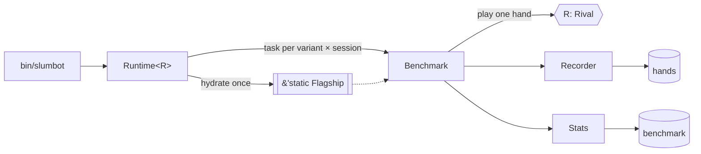

# bout

Benchmark harness for playing the robopoker blueprint against external poker
APIs.

Every published bot speaks a different protocol, but benchmarking one is always
the same job: play hands, record them, count the chips, and say how sure we are.
`bout` owns that job once. A client crate supplies a single trait — `Rival` —
covering only what is genuinely service-specific: its transport, its wire
vocabulary, and the translation into our `Witness`.

| Crate | Opponent | Scores us with |
|---|---|---|
| [`spar`](../spar) | `slumbot.com` | raw chips |

## Layout — one type per file

| File | Type | Role |
|---|---|---|
| `rival.rs` | `Rival` | the one trait a client implements |
| `outcome.rs` | `Outcome` | one hand's bb, plus the opponent's AIVAT if it reports one |
| `stats.rs` | `Stats` | mean / spread / 95% interval, per 100 hands |
| `mode.rs` | `Mode` | fixed sample vs. run-until-stopped, and the pacing each implies |
| `lineup.rs` | `Lineup` | the `--variants` grammar, `*N` session counts included |
| `throttle.rs` | `Throttle` | global in-flight cap on one service |
| `recorder.rs` | `Recorder` | hand-history rows for one session |
| `benchmark.rs` | `Benchmark` | the hand loop, the statistics, the scoreboard row |
| `runtime.rs` | `Runtime<R>` | one container: hydrate once, fan out sessions |

## Adding an opponent

Four things, in this order:

1. **`pokerkit::Adversary`** — a variant with a `service()` token. That one
   string becomes the DB username (`bot:<service>`), the OTLP namespace
   (`rbp.<service>.*`), the scoreboard's `opponent` column, and the
   `records/<service>/` folder. The UUID derives from it, so it is frozen the
   moment a hand is recorded against it.
2. **`vitals`** — a `Bench::build(meter, "<service>")` line in `metrics.rs` and
   a `signed_bb_view` line in the telemetry guard. Then a match arm in
   `Benchmark::family`.
3. **A client crate** implementing `Rival`: `Auth`, `ADVERSARY`, `STACK`, and
   one `play` that runs a hand to completion against a `Recorder`. Override
   `audit` too if the service scores us itself — the harness logs it after
   the run as a check on our own tally.
4. **A binary** wiring `Runtime::<YourSession>::new(auth, …).run()`.

## Invariants

- **`STACK` is our chip scale, not theirs.** Slumbot deals 200 BB, which is
  `STACK * 2 = 400` for us. The client's translate layer is what reconciles
  denominations; the harness only ever sees our chips and bb.
- **One session, one room, one transport.** Concurrent sessions must not share a
  `Recorder` — hand numbering is per-room. `Runtime` enforces this by
  constructing both per spawned task.
- **A failed hand replaces the whole `Rival`.** `fresh` is the reconnect path,
  not just the constructor. Don't add repair logic to a half-dead session; the
  harness throws it away and the client's next `play` re-establishes state.
- **Errors are counted, never swallowed.** A 48-hour run must survive a 5xx, but
  a translation bug that fails every hand has to be visible within a minute —
  hence `rbp.<service>.errors` alongside the warn log.
- **Pacing lives in `Mode`, not the loop.** `Fixed` sprints (throttle-bound,
  operator watching); `Continuous` paces off `<SERVICE>_DELAY_MS` and backs off
  exponentially to a 5-minute ceiling. Adding a knob means touching `Mode`.

## Sessions vs. throttle

Two separate dials, frequently confused:

- **`--sessions N`** (or `*N` on a variant token) is *concurrency of play* — how
  many tokio tasks that variant gets. It exists to fill cores that a single
  player leaves idle during a CFR re-solve. A blueprint lookup wants 1; a
  subgame variant wants roughly one per vCPU.
- **`--throttle N`** is *concurrency of requests* — the global in-flight cap
  across every session. Set it at or above the total session count or sessions
  block on HTTP slots and re-introduce the idle CPU you were trying to remove.
  Lower it, not the session count, if the service starts rate-limiting.

## Reading the results

`bin/scoreboard` ranks every recorded `(regime, version, opponent, variant)`
fingerprint by bb/100 from the shared `benchmark` table, with litmus results
alongside. Pass `--json` for machine-readable output.

Part of the [robopoker](https://github.com/krukah/robopoker) workspace — see the
top-level README for the full architecture and crate map.
