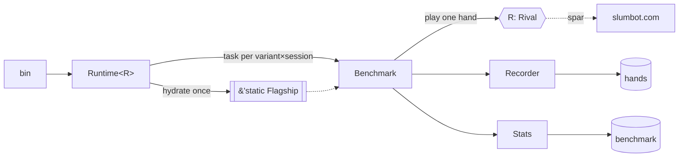

Benchmark harness for playing the blueprint against external poker APIs.

Every published bot we can reach speaks a different protocol, but a
benchmark against one is always the same job: play hands, record them,
count the chips, and say how sure we are. `bout` owns that job. A client
crate supplies only [`Rival`] — its transport, its wire vocabulary, and
the translation into our [`Witness`](kicker::Witness).

| Module | Type | Role |
|---|---|---|
| [`rival`] | [`Rival`] | the one trait a client implements |
| [`outcome`] | [`Outcome`] | one hand's chips, and the opponent's AIVAT if it offers one |
| [`stats`] | [`Stats`] | mean / spread / 95% interval, per 100 hands |
| [`mode`] | [`Mode`] | fixed sample vs. run-until-stopped, and the pacing each implies |
| [`lineup`] | [`Lineup`] | the `--variants` grammar, including `*N` session counts |
| [`throttle`] | [`Throttle`] | global in-flight cap on one service |
| [`recorder`] | [`Recorder`] | hand-history rows for one session |
| [`benchmark`] | [`Benchmark`] | the hand loop, the statistics, the scoreboard row |
| [`runtime`] | [`Runtime`] | one container: hydrate once, fan out sessions |
