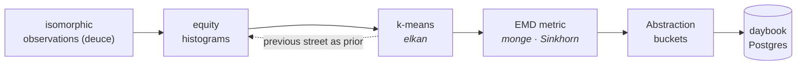
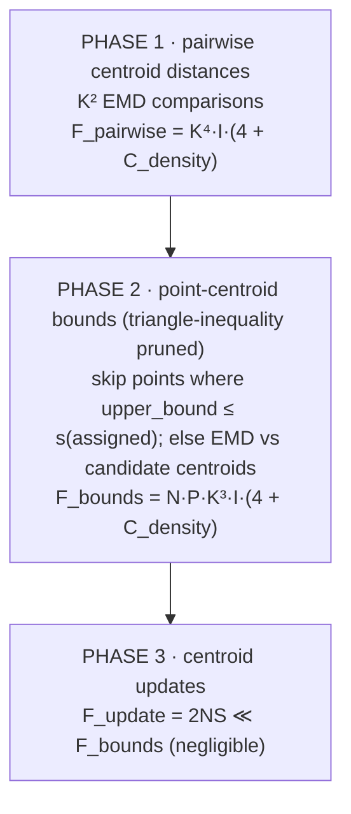
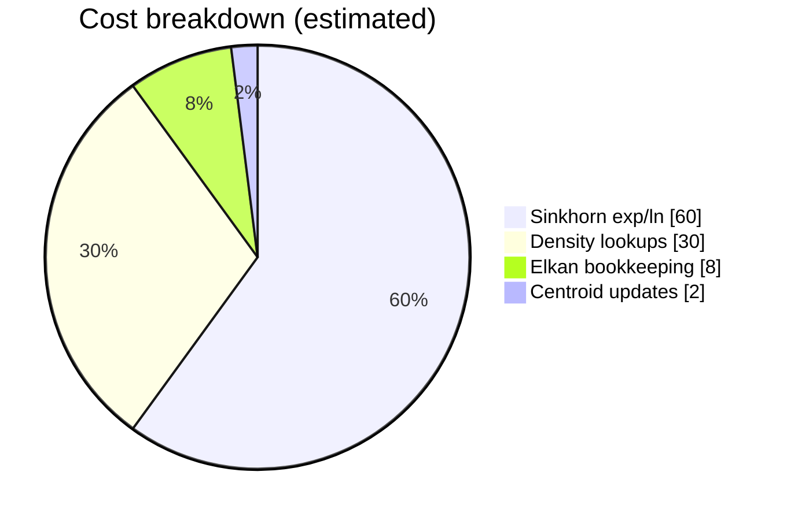

# lloyd

Hierarchical k-means clustering with Earth Mover's Distance for poker hand abstraction
(river → turn → flop → preflop).

## Architecture



Each coarser street clusters over distributions of the *next* street's buckets — hence
the prior edge above.

## Self-cost cache

`transport/sinkhorn.rs` keeps a per-thread cache of `OT_ε(μ, μ)` self-costs, keyed by histogram content
hash + street.

`OT_ε(h, h)` is a pure function of `(h, T, ground_metric)`, so the cache is
correct only under three invariants — all true today, and violating any one
(e.g. a runtime-tunable temperature, a mutating `Metric`) makes it serve
stale values:

1. `SinkhornHyperParams::DEFAULT` is `const`, so `T` never changes within
   a process.
2. Each `Metric` is constructed once (`Metric::set` only runs inside
   `Metric::from`) and never mutated.
3. All `Metric` instances for the same `Street` within a process yield
   identical `raw_distance(x, y)` — they derive from the same DB row set
   or the same deterministic clustering output.

Bounded by clear-on-overflow rather than LRU: the hot-path access pattern
(`K` centroids + `N` points, repeatedly queried) is monotonic within a
phase, so eviction is rare. Sized for the largest per-thread working set on
a Flop run (`N/threads ≈ 160k` points + `K × E ≈ 2.5k` centroid states);
at ~25 bytes/entry that is ~6 MB/thread, ≈ 100 MB over ~16 threads.

## Clustering complexity analysis

Computational cost model for the k-means clustering pipeline.

## High-Level Overview

```
                        CLUSTERING COST MODEL

    ┌─────────────────────────────────────────────────────────────────┐
    │                                                                 │
    │   F_total = E × K³ × I × (4 + C_density) × (K + NP)             │
    │                          ───────────────                        │
    │                           optimizable                           │
    │                                                                 │
    └─────────────────────────────────────────────────────────────────┘

    E = Elkan iterations        K = target centroids
    I = Sinkhorn iterations     N = points to cluster
    P = pruning factor          C_density = density lookup cost
```

The dominant cost comes from **Sinkhorn EMD calculations** in the inner loop of Elkan k-means. Each EMD requires O(K²) density lookups, making `C_density` a critical optimization target. `I` and `E` are capped by `SinkhornHyperParams::DEFAULT` (128 iterations, tolerance-stopped) and `KmeansHyperParams::DEFAULT` (32 per street).

---

## Symbol Definitions

| Symbol        | Definition                                         | Typical Range |
| ------------- | -------------------------------------------------- | ------------- |
| **N**         | Points in layer (histograms to cluster)            | 169 – 14M     |
| **K**         | Target centroids                                   | 169 – 256     |
| **S**         | Support size per histogram (avg non-zero bins)     | 20 – 50       |
| **I**         | Sinkhorn iterations to convergence                 | ≤ 128         |
| **E**         | Elkan iterations                                   | ≤ 32          |
| **P**         | Pruning factor (fraction of N×K computed per iter) | 0.01 – 0.95   |
| **C_density** | Cost of single density lookup                      | 1             |

---

## Per-Operation Costs

### Sinkhorn EMD (One Histogram Pair)

```
                         SINKHORN INNER LOOP
                         (transport/sinkhorn.rs:minimize)

    for _ in 0..I {                          // I iterations
        for x in 0..K {                      // K abstractions
            for y in 0..K {                  // K abstractions
                ┌──────────────────────┐
                │  density(x)          │ <── C_density
                │  density(y)          │ <── C_density
                │  exp()               │ <── 1 FLOP
                │  ln()                │ <── 1 FLOP
                │  mul()               │ <── 1 FLOP
                │  add()               │ <── 1 FLOP
                └──────────────────────┘
            }
        }
    }

    C_sinkhorn = K² × I × (4 + 2 × C_density)
               ≈ K² × I × (4 + C_density)     // amortized
```

### Density Lookup Cost

`Bins<N>` is a fixed, stack-allocated array: `density(&x)` is `counts[x.index()] / weight`, one offset and one divide, so `C_density = 1`.

---

## Elkan K-Means Phases



The bounds in phase 2 are a type parameter of `Layer` (`elkan::Prune`), chosen per street in `forge`:

| Street | Bounds | Memory | Distance calls per iteration (K = 256, random turn points) |
|---|---|---|---|
| Flop | `Bounds<K>` (Elkan: one lower bound per centroid) | N·K·4 B ≈ 1.3 GB | ~1–5% of N·K |
| Turn | `Hamerly<K>` (one lower bound per point) | N·16 B ≈ 220 MB | ~80–95% of N·K |

Elkan on the turn would need ~14.5 GB to prune a 1-D distance that already costs only ~1 min per full pass, so the turn trades ~25 min of iteration for that memory. Both schemes land every point on the same nearest centroid.

---

## Total Cost Formula

### Per Elkan Iteration

```
F_iter = F_pairwise + F_bounds

       = K⁴I(4 + C_density) + NPK³I(4 + C_density)

       = K³I(4 + C_density)(K + NP)
         ─────────────────
              common factor
```

### Total Clustering FLOPs

```
┌─────────────────────────────────────────────────────────────────────┐
│                                                                     │
│   F_total = E × K³ × I × (4 + C_density) × (K + NP)                 │
│                                                                     │
│   where:                                                            │
│     E = Elkan iterations (≤ 32)                                     │
│     K = target centroids (169-256)                                  │
│     I = Sinkhorn iterations (≤ 128)                                 │
│     P = pruning factor (0.01-0.95)                                  │
│     N = points to cluster (169-14M)                                 │
│     C_density = 1 (Bins<N>)                                         │
│                                                                     │
└─────────────────────────────────────────────────────────────────────┘
```

---

## Street-Specific Estimates

### Parameters by Street

| Street  | N          | K   | Clustering        | Distance                                   |
| ------- | ---------- | --- | ----------------- | ------------------------------------------ |
| River   | 123,156,254 | 101 | none (equity bin) | —                                          |
| Turn    | 13,960,050 | 256 | Elkan k-means     | `Equity::variation` over river equity bins |
| Flop    | 1,286,792  | 256 | Elkan k-means     | Sinkhorn divergence over turn buckets      |
| Preflop | 169        | 169 | none (identity)   | Sinkhorn divergence, metric only           |

`Metric::emd` dispatches on the histogram's support street: river-supported histograms (the turn's points) use `Equity::variation` (integrated CDF difference), so the flop is the only street whose k-means runs Sinkhorn. The preflop computes Sinkhorn only for its `169²/2` metric pairs.

### Flop Layer (Dominant Cost)

```
                        FLOP LAYER ESTIMATE
                        N=1.3M, K=256, I=15, E=32, P=0.03

    F_flop = 32 × 256³ × 15 × (4 + 1) × (256 + 1.3M × 0.03)
           ≈ 1.6 × 10¹⁵ FLOPs
```

### Turn and Preflop (Minor)

```
    F_turn ≈ E × N × K × 101   ≈ 10¹³   (1-D distance, no Sinkhorn)
    F_pref ≈ 169² × 256² × I × 5 ≈ 10¹¹
```

---

## Memory and Cache

`Histogram` is an enum over `Bins<N>` sized for the largest street, `1 + 8 + 8·256` B ≈ 2.1 KB. `Layer` storage `Box<[Histogram; N]>` is fully contiguous — Flop ≈ 1.3M × 2.1 KB ≈ **2.7 GB**, Turn ≈ 14M × 2.1 KB ≈ **29 GB**. Density iteration is a sequential array scan: prefetcher-friendly, no pointer chasing, no heap.

---

## Remaining Bottlenecks



Primary bottleneck: transcendental functions (`exp`, `ln`) in Sinkhorn; secondary: the sheer scale of N × K distance calculations.

---

## Future Optimization Opportunities

| Optimization               | Target                | Estimated Impact           |
| -------------------------- | --------------------- | -------------------------- |
| SIMD density lookups       | Inner product EMD     | 2-4× on vectorizable loops |
| Parallel Sinkhorn          | K² divergence calc    | ~Kx with K cores           |
| Approximate NN             | Initial bounds        | 10× on first iteration     |
| GPU offload                | Sinkhorn batches      | 10-100× on matrix ops      |
