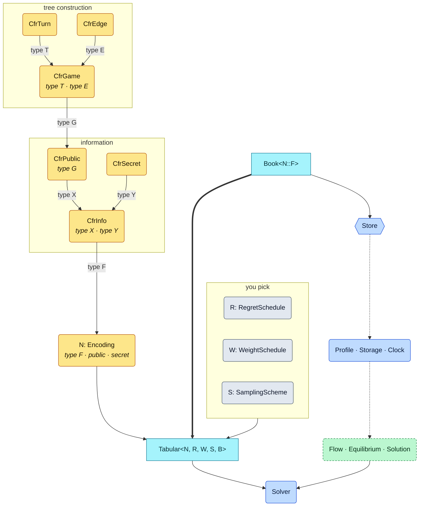
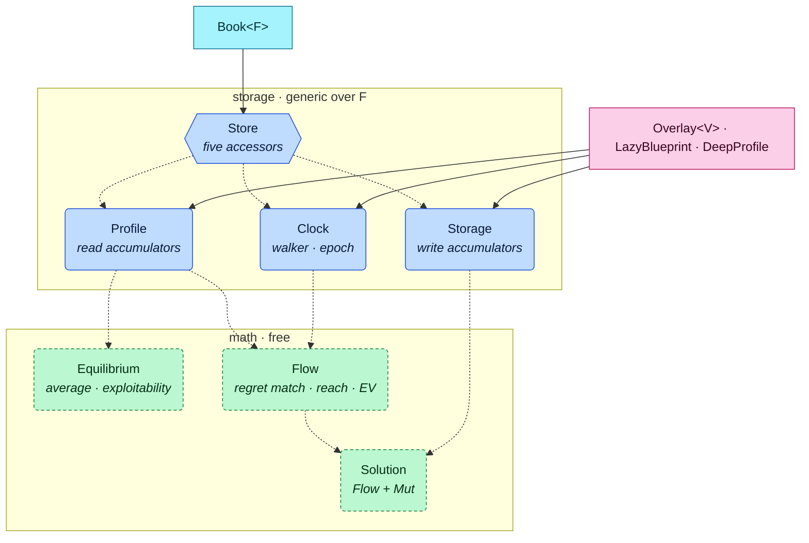
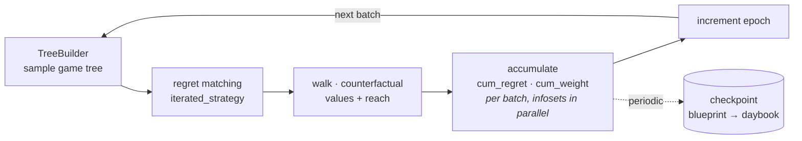
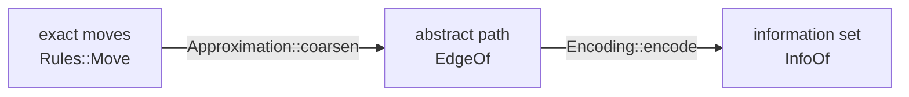

# mccfr

Game-agnostic Monte Carlo CFR framework. Nlhe-specific glue lives in `crates/nlhe/`; the production configuration `Flagship` lives in `crates/nlhe/src/cfr/flagship.rs`.

## Flagship Solver Configuration

The production NLHE solver (`Flagship`) uses Pluribus-inspired settings:

```rust
pub type Flagship = Tabular<
    NlheEncoder,
    LinearRegret,     // Linear CFR = DCFR(1,1,1), the variant used by Pluribus
    LinearWeight,     // Linear weighting of the average strategy
    PluribusSampling, // Probabilistic pruning with exploration
    128,              // trees per batch
>;
```

Algorithm variants are pluggable via generics — swap `LinearRegret` for `DiscountedRegret` (DCFR α=1.5, β=0.5) or `FlooredRegret` (CFR+) to change the regret schedule.

## Implement this, get everything

[`assets/type-map.html`](assets/type-map.html) is an interactive map of every type below: open it in a browser and click a node for its associated items, required and provided methods, and implementors. Update its `NODES` and `VIEWS` tables when a trait in it changes.

Every capability past a game's own definition is a blanket or generic impl. There are three entry points, depending on what you are adding.

Diagram legend, used throughout: **amber** you implement · **slate** a type parameter you pick · **violet** the spec vocabulary · **blue** storage traits · **green, dashed** blanket impls you get free · **teal** generic structs the framework supplies · **rose** `subgame`. Rounded boxes are traits, square boxes are types, the hexagon is an adapter trait whose behavior comes from its blankets. A solid arrow means _names_ or _implements_, a dotted arrow a blanket impl, a thick arrow _holds_. Arrows point from an ingredient to what it builds.



`WorldRestrict` and `Frontier` are optional encoder traits that unlock the `subgame` solvers.

### A new game

Implement these, and nothing else:

| Trait                                    | On                                               | Required items                                        |
| ---------------------------------------- | ------------------------------------------------ | ----------------------------------------------------- |
| `CfrTurn` (+ `From<usize>`)              | your turn type                                   | `chance`, `terminal`, `players`                       |
| `CfrEdge` (+ `monge::Support`)           | your edge type                                   | none (`default_policy`, `default_regret` optional)    |
| `CfrGame`                                | your game state                                  | `type T`, `type E`, `root`, `turn`, `apply`, `payoff` |
| `CfrPublic`                              | the public half of an info set                   | `type G`, `choices`                                   |
| `CfrSecret`                              | the private half                                 | none (a marker)                                       |
| `CfrInfo`                                | the info set, or use the stock `Composite<X, Y>` | `type X`, `type Y`, `public`, `secret`                |
| `CfrSpec` + `Encoding`                 | your encoder                                     | `type F = YourInfo`, `public`, `secret`               |
| `WorldRestrict<W>` (`subgame`, optional) | your encoder                                     | `restrict`                                            |
| `Frontier<D>` (`subgame`, optional)      | your encoder                                     | none; an empty impl gives uniform frontier payoffs    |

Then the solver is a construction, written where it is used:

```rust
let solver = Tabular::<MyEncoder, LinearRegret, LinearWeight, ExternalSampling, 1>::default().solve(trees);
let profile: &Book<MyInfo> = solver.profile();
```

For free:

| Comes from                               | You get                                                                                                                                                            |
| ---------------------------------------- | ------------------------------------------------------------------------------------------------------------------------------------------------------------------ |
| `impl<I: CfrInfo> CfrSpec for I`         | `InfoOf`, `GameOf`, `EdgeOf`, `TurnOf` on every info type, each a route down from it                                                                              |
| `Book<F>` (the profile inside `Tabular`) | `Store`, and through it `Profile`, `Storage`, `Clock`                                                                                                          |
| blankets over those                      | `Flow` (regret matching, reach, `dfs`), `Equilibrium` (average strategy, exploitability, best response), `Solution`, and `AsyncProfile` with the `async` feature |
| `Tabular<N, R, W, S, B>`                 | `Grower` (`tree`, `exploitability`), `Solver` (`solve`, `step`, `batch`), `Encoding` by forwarding, `Display`                                                   |
| `subgame`'s impls for `Tabular`          | `DepthSampler<D>` and `WorldRestrict<W>`, so `DepthSolver`, `WorldSolver` and `SubGameSolver` run over it                                                          |

### A new storage backend for tabular regrets

Implement `CfrSpec` and `Store` (five accessors: `encounters_ref`, `encounters_mut`, `epochs_ref`, `epochs_mut`, `store_metrics`). Blanket impls give `Profile`, `Storage` and `Clock`, then all the math above. `Book<F>` is this, for an in-memory map.

### A profile that is not a map

Implement `CfrSpec`, `Profile` and `Clock` directly (add `Storage` to train it). The math traits follow the same way. This is how the subgame `Overlay<V>`, nlhe's database-backed `LazyBlueprint`, and neural's `DeepProfile` plug in.

## Trait Hierarchy

Three layers: an **info type** names the game's types once, **players** declare which info type they play, and the **CFR math** comes free as blanket impls over the storage traits.

### 1. The info type is the root

Each concrete type is named in exactly one place: the game names its turn and edge, the public half names the game, and the info type names its public half. Every alias is a route down from the info type: `GameOf<X>` is `InfoOf<X>::X::G`, and `EdgeOf` / `TurnOf` read through the game. Pin the info type to fix everything, or label one edge on the route (`F: CfrInfo<X: CfrPublic<G = MyGame>>`) to fix the game and everything below it. There are no equalities pointing back up the route, because rustc rewrites a bound left to right and never solves one backwards. The diagram at the top draws it.

Generic structures take the smallest symbol that determines what they hold:

| Parameter    | Structures                                                                                     |
| ------------ | ---------------------------------------------------------------------------------------------- |
| `F: CfrInfo` | `Tree<F>`, `Node<'_, F>`, `InfoSet<F>`, `Decisions<F>`, `Batch<F>`, `TreeBuilder<'_, N, P, S>` |
| `G: CfrGame` | `Leaf<G>`, `Branches<G>`, `Prefix<G>` / `Replay<G>` / `Story<G>`, `DescentOf<G>`               |
| `E: CfrEdge` | `Over<E, K>`, `Decision<E>`, `Harvested<E>`                                                    |

### 2. Players and the math they get

Encoders, profiles and solvers implement `CfrSpec` with one line (`type F = MyInfo;`) and read the rest back through `InfoOf<X>`, `GameOf<X>`, `EdgeOf<X>`, `TurnOf<X>`. Two players agree on a game with one equality: `P: Profile<F = N::F>`.



| Trait         | Kind                             | Provides                                                                                      |
| ------------- | -------------------------------- | --------------------------------------------------------------------------------------------- |
| `CfrSpec`     | implement                        | the info type `F`                                                                             |
| `Encoding`  | implement                        | `public` (state and past edges, nearest first) and `secret` (state): the two halves of an info set |
| `Profile`     | implement                        | `cum_weight`, `cum_regret`, `cum_payoff`, `cum_visits`, epoch `t`                             |
| `Storage`     | implement                        | `mut_weight`, `mut_regret`, `mut_payoff`, `mut_visits`                                        |
| `Clock`     | implement, on top of `Profile`   | `increment`; `walker` defaults to `t % players`; sampling hyperparameters                     |
| `Store`     | implement                        | one map + epoch; blanket-provides `Profile`, `Storage`, `Clock`. `Book<F>` is the stock one |
| `Equilibrium` | blanket over `Profile`           | `averaged_policy`, `exploitability`, best response                                            |
| `Flow`     | blanket over `Profile + Clock` | regret matching, reach, `dfs`, regret and policy vectors                                      |
| `Solution` | blanket over `Flow + Storage` | the bound `Solver` needs                                                                      |
| `Grower`     | implement                        | `type N`, `type P: Flow`, `type S`; provides `tree`, `root`, `exploitability`              |
| `Solver`      | implement (or use `Tabular`)     | over `Grower<P: Solution>`: the batch → regret → update loop                              |

A game needs no glue beyond its encoder. `Tabular<N, R, W, S, B>` is a `Solver` for any encoder `N`, over a `Book<N::F>` profile with `B` trees per batch:

```rust
let kuhn = Tabular::<KuhnEncoder, LinearRegret, LinearWeight, ExternalSampling, 1>::default().solve(1 << 18);
let book: &Book<KuhnInfo> = kuhn.profile();
```

Subgame solving comes the same way: `subgame` implements `DepthSampler` and `WorldRestrict` for every `Tabular` whose encoder implements `Frontier<D>` (the default is uniform frontier payoffs) and `WorldRestrict<W>`.

### 3. One iteration

One MCCFR iteration per sampled tree, driven by `Solver` over a `Solution`:



Accumulators on `Profile`:

- **`cum_weight`**: accumulated weighted strategy, normalized into the average policy
- **`cum_regret`**: accumulated counterfactual regret, regret-matched into the current policy
- **`cum_payoff`**: running mean of the infoset's value, read at depth-limited frontiers

Strategies derived from them:

- **`iterated_strategy`** (`Profile`): the current iteration's strategy by regret matching
- **`averaged_strategy`** (`Profile`): the historical average, which approximates Nash
- **`sampling_strategy`** (`Flow`): the exploration-adjusted distribution the sampler draws from

### 4. The pure game and its two quotients

`Rules` is the pure game: exact moves, deterministic transitions. An `Approximation` quotients its edges (`coarsen`, with `refine` as the section) and an `Encoding` quotients its nodes into information sets, as two projections of the full state: `public` reads the path, `secret` reads the state, and `encode` is their `CfrInfo::join`. Both read the state and the path's abstract edges nearest first, the order a `Node` walks upward, so history lives in the tree, not the state. A game whose edges are already lossless (Kuhn, Leduc, RPS) is its own pure game; NLHE pairs `NlheRules` with `NlheGrid`.



## Solver Configuration Constants (`lib.rs`)

- **MCCFR Batching**: `CFR_BATCH_SIZE_*`, `CFR_TREE_COUNT_*`
- **Sampling**: `SAMPLING_TEMPERATURE` (T), `SAMPLING_SMOOTHING` (β), `SAMPLING_CURIOSITY` (ε)
- **Regret Matching**: `POLICY_MIN`, `REGRET_MIN`
- **Probabilistic Pruning**: `PRUNING_THRESHOLD`, `PRUNING_EXPLORE`, `PRUNING_WARMUP`
- **Regret Bias**: `BIAS_FOLDS`, `BIAS_RAISE`, `BIAS_OTHER` (initial warmstart weights)

## Training Pipeline

```bash
# Generate abstractions and upload to PostgreSQL (resource intensive)
cargo run --bin trainer --features database -- --cluster

# Train blueprint strategies (in-memory MCCFR)
cargo run --bin trainer --features database -- --fast

# Train blueprint strategies (distributed workers)
cargo run --bin trainer --features database -- --slow
```

**Training modes:**

- `--status` — Check database training progress (epochs, infosets)
- `--cluster` — Generate hand abstractions via hierarchical k-means (run once, resource intensive)
- `--fast` — Single-machine in-memory MCCFR (uses `FastSession`)
- `--slow` — Distributed workers with PostgreSQL synchronization (uses `SlowSession`)
- `--reset` — Clear blueprint/epoch tables for fresh training run

**Environment variables:**

- `TRAIN_DURATION` — Optional timed training (e.g., `TRAIN_DURATION=2h` or `30m` or `1d`)
- Type `Q` + Enter during training for graceful shutdown after current batch

## Telemetry note

`mccfr_infoset_size` emits one record per filtered infoset per tree per batch (`batch_size=128 × ~K_infosets`, runtime-bounded). At ~200K infosets/batch this is ~20-100 ms per batch. Batches are now sub-second, so the per-tree and per-infoset histograms record on one batch in `Solver::SAMPLE_EVERY` (17); recording every batch serialized rayon workers on the histogram locks. See `crates/vitals/README.md` for the full cost-intuition writeup.

Records are emitted unlabeled. The metric is a **smoke detector** — it exists to tell you a pathological tail showed up, not to tell you which dimension drives it. NLHE infoset keys already fold over street (4), abstraction bucket (~128–144), subgame action sequence, choices mask, and SPR (4); none of those are labels. Adding labels per dimension would force the label cardinality story and pull game-specific concepts (e.g. `gameplay::SPR`) into the generic mccfr emission site for marginal diagnostic value. When the tail does spike, the right next step is a DB query or ablation, not reading the histogram more carefully.
