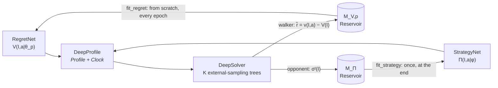
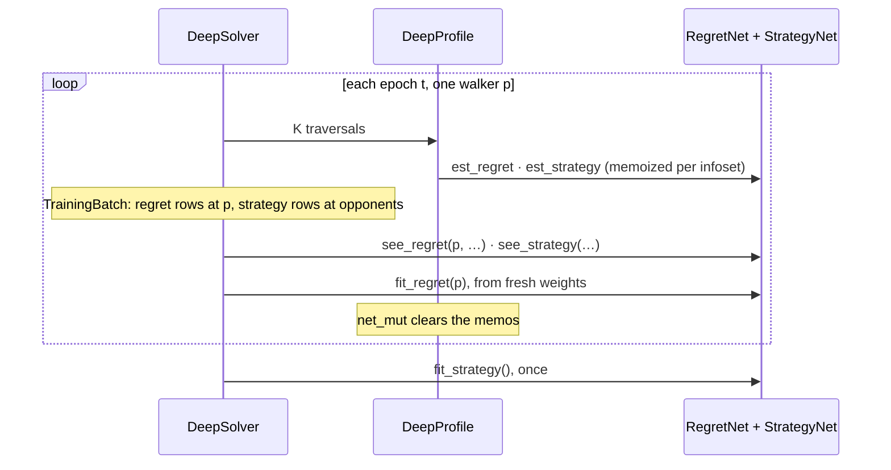
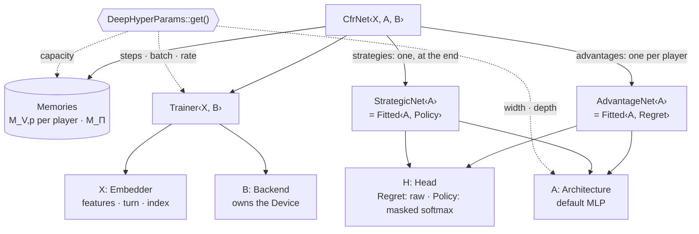
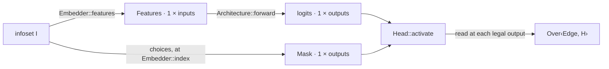
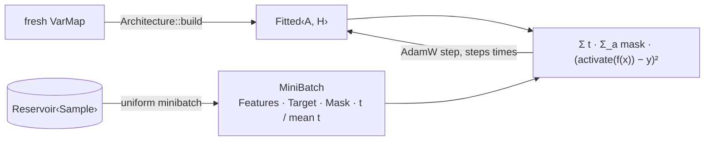

# neural

Deep CFR over the game-agnostic [`mccfr`](../mccfr) framework: two function approximators replace the regret and strategy tables, and the CFR math stays the same.

> Brown, N., Lerer, A., Gross, S., & Sandholm, T. (2019). **Deep Counterfactual Regret Minimization.** _NeurIPS 2019_. [arXiv:1811.00164](https://arxiv.org/abs/1811.00164)

Part of the [robopoker](https://github.com/krukah/robopoker) workspace. See the top-level README for the full crate map.

## Architecture



One epoch reads frozen networks throughout, and only then observes and refits:



| Module           | Holds                                                                                                                                                               |
| ---------------- | ------------------------------------------------------------------------------------------------------------------------------------------------------------------- |
| `network/`       | `RegretNet` and `StrategyNet`, the approximator traits. Also `MockNet`, a tabular implementation of both.                                                           |
| `memory/`        | `Reservoir` (Algorithm R), `Sample`, a row of (infoset, iteration `t`, per-edge target), and `Memories`, the three reservoirs every network keeps.                  |
| `profile.rs`     | `DeepProfile<N>`, which implements `mccfr::Profile` + `mccfr::Clock` over any `N: RegretNet + StrategyNet`.                                                       |
| `memo.rs`        | `Memo`, a sharded read-through cache, and `Predictions<N>`, one per network in `DeepProfile`, so each infoset costs one forward pass per network change.            |
| `solver.rs`      | `DeepSolver`, the training loop. Like `mccfr::Solver`, it extends `mccfr::Grower`, which builds its trees and measures exploitability.                             |
| `batch.rs`       | `TrainingBatch` captures regret and strategy rows as each traversal is partitioned; observations wait until every frozen-net traversal finishes.                    |
| `cfr.rs`         | `DeepCfr<N, P, S>`, a `DeepSolver` for any encoder `N`, network pair `P`, and sampling scheme `S`.                                                                  |
| `hyperparams.rs` | `DeepHyperParams`: every knob — traversals `K`, reservoir capacity, network shape, and fitting.                                                                                              |
| `embedding/`     | `Block`: a type's own slice of the input row (`WIDTH` values); a composite chains its parts' blocks, so an info type that is a `Block` gives `inputs` and `features` directly. `Embedder`: an infoset as `Features` (`inputs` wide), each edge as its `index` among the net's `outputs`, and the player whose network answers. A game's only input to a real net. `Mask` and `Target` lay an infoset's legal edges and a sample's target over those outputs. |
| `candle/`        | `CfrNet<X, A, B>`: memory, a `Trainer<X, B>`, and both networks as `Fitted<A, H>` — `AdvantageNet<A>` per player, one `StrategicNet<A>` — for any candle `A: Architecture` (default `MLP`) on any `B: Backend` (default `CPU`), over any `X: Embedder`, shaped and fit by `DeepHyperParams`. Each optimizer step reads one `MiniBatch` of tensors. |

## How it maps onto `mccfr`

| Tabular MCCFR                           | Deep CFR here                                                        |
| --------------------------------------- | -------------------------------------------------------------------- |
| `cum_regret(I, a)` lookup               | `RegretNet::est_regret(I)`                                           |
| regret matching floored at `ε`          | `RegretNet::matched`: when no advantage is positive, play the argmax |
| `averaged_strategy` from `cum_weight`   | `StrategyNet::est_strategy(I)`                                       |
| `Solver::apply` → `R::gain`, `W::learn` | `see_regret` / `see_strategy` → reservoir                            |
| regret discounting (`LinearRegret`)     | loss weighted by `t` (`Sample::weight`)                              |
| tabular `Solver`                        | `DeepSolver`                                                         |

`DeepProfile` implements `Profile` and `Clock`. So `Flow` (reach, `dfs`, regret vectors), `Equilibrium` (exploitability, best response), and every `SamplingScheme` run on networks with no new code.

## Usage

```rust
use kuhn::*;
use mccfr::*;
use neural::*;

let solver = DeepCfr::<KuhnEncoder, MockNet<KuhnInfo>, ExternalSampling>::default()
    .solve(1 << 10);
println!("{}", solver.exploitability());
```

A real network needs only an `Embedder` for the game:

```rust
let solver = DeepCfr::<KuhnEncoder, CfrNet<MyEmbedder>, ExternalSampling>::default()
    .solve(1 << 10);
```

Any other backend implements `RegretNet` and `StrategyNet` on one type and passes it as `P`.

## `CfrNet`

`CfrNet` keeps one advantage net per player, re-initialized and fit on that player's memory every time they walk, and one strategy net fit once at the end. The game enters only through `Embedder`, the device only through `Backend`, the layers only through `Architecture`, and the readout only through `Head`.

[`assets/networks.html`](assets/networks.html) draws these networks: open it in a browser to follow one forward pass for the Kuhn or RPS embedder, see which net answers in each epoch, and walk through one fit. Update it when `CfrNet`, an `Embedder`, or `DeepHyperParams` changes.



A prediction is one forward pass. The embedder gives every edge a fixed output `index`, so the number of outputs never depends on the infoset; the `Mask` marks the outputs this infoset can play.



`CfrNet::save` writes the fitted strategy net to `strategy.safetensors` in a directory, and `CfrNet::load` reads it back into a net with empty memories. The shape comes from the embedder and `DeepHyperParams`, so load under the same settings that saved. Advantage nets refit from memory every epoch, so they are not saved.

A fit builds into a fresh `VarMap`, so it starts from new weights, then runs AdamW on uniform minibatches toward the paper's `t`-weighted squared error over legal outputs. Weights divide by the memory's mean `t`, not the batch's, so repeated rows keep their weight.



For NLHE the outputs are the static bet-sizing grid, and `Size::raises(street, depth)` only changes the mask. An illustrative mask:

| output       | fold | check | call | `Size` 0 |  …  | `Size` n | shove |
| ------------ | :--: | :---: | :--: | :------: | :-: | :------: | :---: |
| facing a bet |  1   |   0   |  1   |    1     |  …  |    0     |   1   |
| checked to   |  0   |   1   |  0   |    1     |  …  |    1     |   1   |

## Validation

`cargo test -p neural` checks Deep CFR against known solutions, the same `kuhn::KuhnNash` and `roshambo::RpsNash` the tabular tests use:

| Test                                    | Network     | Bar                                                                                                      |
| --------------------------------------- | ----------- | -------------------------------------------------------------------------------------------------------- |
| `cfr::tests::kuhn_matches_nash`         | `MockNet`   | all 12 Kuhn targets at the tabular tolerances, after 4,096 epochs                                        |
| `cfr::tests::rps_matches_nash`          | `MockNet`   | within 0.02 of R 0.4, P 0.4, S 0.2                                                                       |
| `candle::net::tests::rps_matches_nash`  | `CfrNet`    | within 0.05 (ignored; release)                                                                           |
| `candle::net::tests::kuhn_matches_nash` | `CfrNet`    | all 12 targets at 3× the tabular tolerances, printing the misses at 1× (ignored; ten minutes in release) |

`MockNet` is the perfect-network reference: each fit is the exact minimizer of the paper's loss over its memory, so with unbounded memory it reproduces sampled Linear CFR. Where `MockNet` passes and `CfrNet` misses, the gap is function approximation, not the Deep CFR loop. Exploitability alone is too weak a bar: near-indifferent actions cost little to get wrong, so a profile 0.02 exploitable can still miss an equilibrium frequency by 0.1.

## Invariants

- `neural` depends on `mccfr`; `mccfr` never depends on `neural`. Anything the adapter needs is a `Profile` / `Clock` override in `profile.rs`.
- `RegretNet::matched` is the only regret-matching rule: with no positive advantage it plays the argmax, not `mccfr`'s `EPSILON` floor.
- Sampling stays on-policy (temperature 1, smoothing 0, curiosity 0), so `dfs` returns the paper's `r̃`. These knobs change the training targets, not only exploration.
- Regret rows come from walker infosets, strategy rows from opponent infosets, unlike the tabular `Solver`.
- Networks stay frozen for a whole epoch, and every mutation goes through `DeepProfile::net_mut`, which clears the per-infoset memos.
- A game reaches a real network only through `Embedder`; `Backend` owns the `Device`, `Architecture` owns the layers, `Head` owns the readout.
- Every knob lives in `DeepHyperParams`, set once with `init`. Tests run on `Default`, so the defaults are what the Nash tests validate.
- Deep CFR trains no value network, so `cum_payoff`, `cum_visits`, and `sum_regret` carry nothing: subgame and depth-limited solving cannot use a `DeepProfile` as a blueprint.
