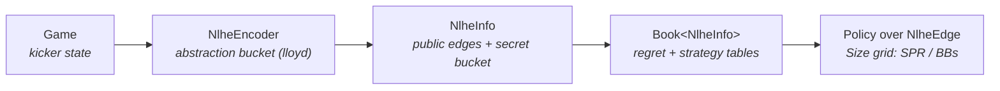

# nlhe

No-Limit Hold'em CFR implementation bridging `kicker` and `mccfr`. Game-tree shape and bet-sizing abstraction live here.

How a live game state becomes a policy lookup:



| Module | Holds |
|---|---|
| `state/` | The CFR newtypes over `kicker`: `NlheEdge`, `NlheGame`, `NlheTurn`, `NlheInfo` = `NlhePublic` + `NlheSecret` |
| `cfr/` | The `Flagship` configuration of `Tabular<NlheEncoder, …>`, the `NlheSolver` queries, `NlheEncoder`, and the subgame samplers `Adapt` / `Nest` |
| `blueprint/` | Trained-strategy views: `Strategy`, `Memory`, `Record`, `Lookup`, and the DB-backed `LazyBlueprint` |
| `store/` | PostgreSQL I/O (`server` feature): `Source`, `Sink`, the binary-COPY `Wire`, and the blueprint table `NlheBlueprint` |

## Bet Sizing Abstraction

The `Size` enum is the **single source of truth** for which betting edges exist in the game tree:

```rust
pub enum Size {
    SPR(Chips, Chips),  // Pot-relative: SPR(1, 2) = half pot
    BBs(Chips),         // BB-relative: BBs(3) = 3BB open
}
```

`Size::raises(street, depth)` returns available raise sizes per `(street, depth)`. Defined as `PLURIBUS_INDICES` in `crates/pokerkit/src/consts.rs`. The grid is keyed only on `(street, depth)` — there is **no SPR axis on the menu**, and the InfoSet key does not carry an SPR bucket. Pot-relative sizing already self-scales with stack depth (1× pot at SPR=1 *is* all-in), and `Edge::Shove` is always available regardless of the menu, so the implicit absorbing state handles the SPR collapse without a dedicated key dimension.

The design memo (archived at `docs/archive/grid-v3.md`) summarizes published menus from Pluribus, Libratus, DeepStack, Slumbot, and GTOWizard — none of those systems condition the menu on an SPR bucket.

### Menu per row

| Row | Menu | Source |
|---|---|---|
| Pref/0 (opens) | `OPENS = [2, 3, 4, 5]` BB | Wider than Pluribus's 2.0–2.5 empirical; preflop is well-trained and the extra width is harmless |
| Pref/1 (3-bet) | `[1:1, 2:1, 3:1]` | 63% of Pluribus 3-bets exceed 2:1; without 3:1 the next rung is all-in (`docs/active/phh-evaluation.md`) |
| Pref/N (4-bet+) | `[1:1, 2:1]` | Every Pluribus 4-bet exceeds 1:1 |
| Flop/0 | `[1/4, 1/2, 1:1, 2:1]` | GTOWizard SRP-IP menu less `3:4`, which Pluribus never plays (0 of 3,059) |
| Flop/1 | `[1/2, 1:1]` | Pluribus-faithful shrink on 2nd raise |
| Flop/N | `[1:1]` | Raise war |
| Turn/0 | `[1/3, 1/2, 1:1, 2:1]` | Geometric setup, 4 sizes |
| Turn/1 | `[1:1, 2:1]` | |
| Turn/N | `[1:1]` | |
| Rive/0 | `[1/3, 1/2, 1:1, 2:1]` | Polar + block bet |
| Rive/1 | `[1:1, 2:1]` | |
| Rive/N | `[1:1]` | |

### Two SPRs (the historical confusion)

- **`Size::SPR(n, d)`** — encoded *bet size* (pot-relative numerator/denominator). Lives on `Edge::Raise`. The thing the action enum carries.
- **`gameplay::SPR`** — discrete 4-bucket *stack-to-pot ratio* (`Committed` / `Low` / `Mid` / `Deep`, boundaries `[1.5, 4.0, 10.0]`), defined at `crates/kicker/src/table/geometry.rs`. Computed from live `Game::geometry()`. **Not on the InfoSet key.** Still surfaced via `ApiStrategy.spr` for FE display and via the litmus `expected_spr` validator as a sanity check on history-definition chip dynamics.

## Game Tree Constants (`pokerkit`)

- `N` — Number of players
- `STACK` — Starting stack
- `B_BLIND`, `S_BLIND` — Blinds
- `MAX_RAISE_REPEATS` — Max consecutive raises before tree truncation
- `MAX_PATH_EDGES` — Max edges in any tree path
