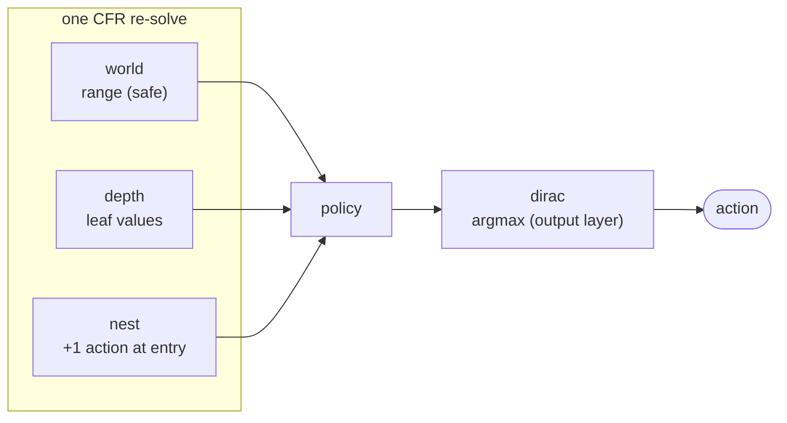

Player implementations for different game contexts.

The bot zoo is compositional: every axis is a [`Brain`] wrapper.
[`Blueprint`] is the leaf (in-memory lookup); [`Depth<B>`] / [`World<B>`]
add subgame solver layers; [`Dirac<B>`] sharpens the inner distribution to
a Dirac delta. Stack in canonical order (`Dirac<World<Depth<Blueprint>>>`)
and wrap with [`Agent<B>`] to get a `Player`. [`Tag::zoo`] is the single
runtime → comptime binding both `bout` (Slumbot) and the hosting server use.

Four dials, but **not** a free `2^4`: three are an orthogonal cube, the
fourth (nesting) is a *conditional* layer.

- **`Dirac`** is a pure *output* transform (argmax the final policy). Orthogonal
  to everything, including "no solve": `Dirac<Blueprint>` is valid. Factor it out
  — every row below also has a `Dirac<…>` twin.
- **`Depth` ⟂ `World`** — leaf evaluation vs opponent range; independently toggleable.
- **`Nest` is conditional.** Nesting is a re-solve *trigger + a menu edit*, not a
  solving method, so it needs a solve to attach to. It's driven by
  [`Translation::Exact`](pokerkit::Translation) at runtime (not a `Config` bool),
  and zoo wires it as a world-subgame re-solve: **nest ⟺ (`Exact` ∧ `world`)**,
  independent of the `depth` dial (which shapes only the on-tree fallback brain).

Validity (× `Dirac` for each row):

| depth | world | nest | meaning | status |
|:-:|:-:|:-:|---|---|
| – | – | – | blueprint (no re-solve) | ✓ wired |
| ✓ | – | – | depth-limited solve | ✓ `adapt_leaf` |
| – | ✓ | – | safe full-tree solve | ✓ `adapt_safe` |
| ✓ | ✓ | – | safe depth-limited solve | ✓ `adapt_full` |
| – | – | ✓ | nest, no solve to attach | ✗ incoherent (nothing to augment → = translation) |
| ✓ | – | ✓ | nest, range layer off | ✗ not built — zoo gates nesting on `world` |
| – | ✓ | ✓ | nest over safe fallback | ✓ `Nest<World<…>>` (nested solve = `adapt_nested`) |
| ✓ | ✓ | ✓ | nest over safe+depth fallback | ✓ `Nest<World<Depth<…>>>` (nested solve = `adapt_nested`) |

**What the dials do under `nest`:** both wired nest cells run the *same* nested
re-solve — `adapt_nested` (safe + depth) — so the `depth`/`world` dials select
only the *on-tree fallback* brain `Nest<B>` delegates to when the line stays
on-grid, not the nested-solve method. A depth-less or unsafe *nested* variant
isn't wired; adding one lets `Nest<B>` pick per dial.

The *solve*-axis concepts (world/depth/nest orthogonality) are in
[`crates/subgame/README.md`](https://github.com/krukah/robopoker/blob/main/crates/subgame/README.md); this section is the
player-side view that also folds in `Dirac` and the zoo wiring.
