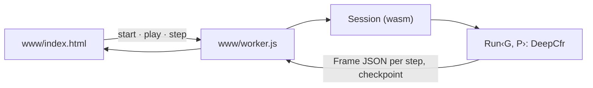

# petri

Deep CFR on Kuhn and rock-paper-scissors, live in a browser. The [`neural`](../neural) training loop — `DeepCfr` under external sampling, with `CfrNet` or `MockNet` — compiled to WebAssembly and run in a Web Worker. The page draws what the live `DeepProfile` reports; nothing is simulated.



```bash
crates/petri/build.sh         # build, bind, serve on http://localhost:8787
crates/petri/build.sh build   # build only; needs `rustup target add wasm32-unknown-unknown`
```

`build.sh` sets `--cfg getrandom_backend="wasm_js"` for the wasm32 target only; a bare `cargo build -p petri --target wasm32-unknown-unknown` needs the same flag.

| File | Holds |
| --- | --- |
| `session.rs` | `Session`, the wasm export: one run per worker, since `DeepHyperParams` is set once |
| `run.rs` | `Run<G, P>`: steps the solver; a checkpoint fits the strategy net and reads exploitability |
| `probe.rs` | `Probe`: the infosets to draw and their Nash targets, for `KuhnEmbedder` and `RpsEmbedder` |
| `frame.rs`, `reading.rs`, `lane.rs` | What the page draws, per step, per infoset, per edge |
| `knobs.rs` | `Knobs`, the page's JSON form of `DeepHyperParams` |

The embedders are `neural`'s own test embedders, compiled in by `#[path]`, so the page trains exactly what the Nash tests train. `kuhn` and `roshambo` gate `mccfr/server` behind their default `server` feature; petri turns it off, since tokio does not build for wasm32.
