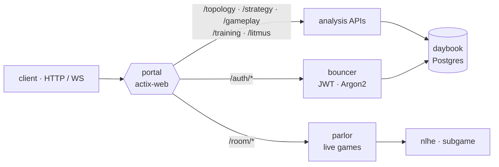

# portal

Unified actix-web server: the analysis API (`topology`, `strategy`, `gameplay`, `training`, `litmus`) and live game `hosting`.



## Run

```bash
# Unified server (analysis API + live game hosting); needs DB_URL, reads JWT_SECRET
BIND_ADDR=0.0.0.0:8888 cargo run --bin backend -- --regime pluribus --version v1

curl http://localhost:8888/health
curl -X POST -H "Content-Type: application/json" \
  -d '{"street": "P"}' http://localhost:8888/topology/exp-wrt-str
```

`SKIP_BLUEPRINT=1` skips loading the blueprint into memory; only `Fish` opponents then work.

## Routes

- `/health` — health check
- `/auth/*` — `register`, `login`, `logout`, `me`
- `/room/*` — live game hosting: `start`, `enter/{room_id}`, `leave/{room_id}`
- `/topology/*` — abstraction neighbors, expectations, histograms, distances, bucket glosses
- `/strategy/*` — blueprint policy, `depth`/`world`/`full` re-solves, `range`, `grid-usage`
- `/gameplay/*` — hand histories, summaries, AIVAT
- `/training/*` — status, snapshots, convergence
- `/litmus/*` — run the litmus catalog, as JSON or markdown
