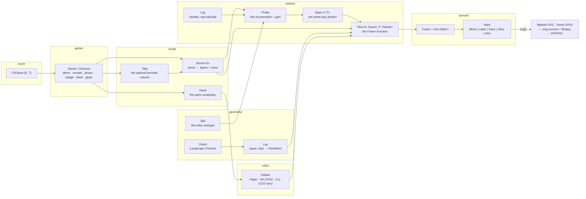

# reel

The Frame Function: one tree geometry, two orientations, many frames —
generic up to the mccfr trait hierarchy. Renders any `CfrGame`'s tree as a
scripted, deterministic animation: an authored hand explored phase by phase,
one trajectory per frame, the chosen line freezing the way the site's Tree
panel draws it (taken cell lit and ringed, siblings at 40%) before the next
phase is revealed. NLHE ships in both orientations; a Kuhn reel renders from
one ~70-line `Scenic` impl — the genericity proof.



## Module layout

Every directory re-exports flat, so the public API is `reel::*` regardless of depth.

| Directory | Owns |
|---|---|
| `game/` | the mccfr seam — `Scenic`, `Atlas`, the NLHE and Kuhn impls |
| `game/chart/` | client-facing data over a game: `Range`, `Posterior`, `Verdict` |
| `script/` | the authored hand — `Demo`, `Step`, `Scene`, `Layer`, `Stint`, `Tally`, `Deed` |
| `geometry/` | (layer, slot) layout — `Lay`, `Orient`, `Brink`, `Slot` |
| `geometry/coord/` | coordinates — `Along`, `Cross`, `Axial`, `Point`, `Rect` |
| `motion/` | choreography on the reel clock — `Film`, `Span`, `Probe`, `Lcg`, `Easing` |
| `canvas/` | pure render data — `Frame`, `Mark`, `Anchor`, `Face`, `Token`, `Rune` |
| `color/` | the paint seam — `Palette`, `Paper`, `Ink`, `Css`, `Paint`, `Tint` |
| `panels/` | composed panels — `Panel`, `Ensemble`, `Trio`, `Curve`, `Dial`, `Sheet` |


## The unification

- **All layout happens in abstract (layer, slot) space**; `Orient` is a single
  axis swap, so the horizontal (`Landscape`) and vertical (`Portrait`) trees
  are two projections of one structure. Glyphs stay upright in both.
- **`Mark` is pure data** — renderable to SVG strings, and mounted as
  views by the closed-source Leptos client. Frame equality is structural, which powers the
  no-jitter dedup.
- **`Palette` is the paint seam**, and the site's theme is its source of
  truth: `Paper` is the light register (the default look) and `Ink` the dark
  one, both as concrete hex for the standalone assets; `Css` produces
  `var(--…)` references so the client's theme owns the values. Same film,
  three worlds. See [Registers](#registers).
- **Generic up to mccfr**: all game specifics enter through `Scenic`
  (`demo`/`reveals`/`phase`/`badge`/`deed`/`glyph`); menus are the REAL legal
  actions along the demo line, not authored mirrors. `Deed` is the semantic
  action vocabulary the palette speaks, so paint never sees an edge type.
  `Slot` types every tile index.
- **Major and minor ranks**: `Layer::Board` and `Layer::Settle` are the
  boundaries that open and close a phase — each drawn on a full-height
  lane of street material (pocket stock, felt, settlement parchment).
  `Layer::Choice` is the minor rank that lives between them, on the tree's
  bare striped ground. Every band, caption, and
  token face goes through the same `faces()`/`caption()` pair, so a new
  major rank costs one enum arm, not a second drawing path.
- **One type per file, everywhere** — 46 modules across the directories
  above, each owning exactly one struct/enum/trait.

## Registers

Every slot a `Palette` exposes is one CSS token from the closed-source
client's theme, so the reels match the live site. Change a value there,
change it here.

| Slot | Token | `Paper` (light) | `Ink` (dark) |
|---|---|---|---|
| `bg` | `--tm-bg` | `#eeebe4` paper | `#0c0d0f` ink |
| `fg` | `--tm-fg` | `#16181a` paperInk | `#e9eaec` inkText |
| `muted` | `--tm-muted` | `#6d6961` | `#8b929b` |
| `border` | `--tm-border` | `#d6d2c8` paperRule | `#2a2e34` inkLine |
| `inverse` | `--tm-inverse` | `#faf9f6` | `#0c0d0f` |
| `ground` | `--tree-band-a` | `#e6e2d6` | `#15161a` |
| `stripe` | `--tree-stripe` | white 22% | white 4.5% |
| `felt` | `--felt` | `#2f5a4b` | `#164e51` |
| `pocket` | `--street-private` | `#d6d0c1` | `#2b2b33` |
| `settle` | `--street-settle` | `#e9d5aa` | `#4a3a14` |
| `white` / `black` / `red` | `--card-*` | `#fff` / `#000` / `#dc2626` | same |
| `gold` | `--accent-gold` | `#946512` | `#fbbf24` |
| `observed` | `--hist-obs-stroke` | `#a8322c` | `#f87171` |
| `range` | `--range-color` | `#7a4a12` sepia | `#eadcc2` cream |
| `action` | `--action-{fold,check,call,raise,allin}` | muted printed inks | 400-tier |

`Deed::Raise` grades gold to red over pot ratio in every world (`Paint::grade`,
shared with the client), and `regret` is the reel's own: `Paper` blends fold
grey toward the raise/call inks, `Ink` toward the bright warm/cool pair.

Type follows the site too: `Face::Text` and `Face::Caps` are `--font-text`
(Barlow, with `Caps` tracked 0.1em like the tree's gutter), `Face::Data` is
`--font-data` (IBM Plex Mono) for chip counts and axes, and `Face::Pip` is the
suit glyph. Install both families before rasterizing so the rasters match; an
SVG viewed elsewhere falls back to the platform sans/mono.

## The settlement column

A scene may close with a `Tally`: the seat that took the pot (actor band),
how the hand ended (phase band), and the result tiles. It is **optional** —
attached by `Demo::settled`, appended by `Scene`, painted only in the
`close()` frame. The Kuhn reel ships without one, which is the proof that
the geometry, the spine, and the canvas all measure one column shorter when
it isn't there.

Painting it only at `close()` is deliberate: during the last phase the hand
hasn't ended yet, and a gold band sitting there would spoil an outcome the
probes are still exploring.

NLHE fills it the same way the closed-source client's tree does — final pot, then what
hero walked away with: the signed net when a fold settles it, hero's made
hand when a showdown leaves villain's cards hidden. A `Witness` never holds
villain's cards, so neither surface ever invents a winner.

## Choreography invariants

Authored, not random (every "stochastic" choice is a seeded `Lcg`). Every
street lasts exactly `SPAN` frames; probes grow one edge per frame and reset
sharply; no two consecutive identical edges within a line; folds and calls
terminate a line; consecutive probes open with different first actions; the
chosen non-folding line closes each street and freezes in `fg`; later streets
stay hidden until reached; the settlement lands only on the completed hand;
only that completed hand lingers (`LINGER`).

## Usage

```bash
cargo run -p reel   # → docs/assets/components/<name>-{light,dark}.svg
                    #   + docs/assets/_frames/<name>-{light,dark}/{NNNN,still}.svg
```

Rust owns the frames; pixels are left to external tools. To rasterize a reel,
convert each staged frame with `rsvg-convert -z 2` and stitch the PNGs with
`ffmpeg -framerate 20` (a `palettegen`/`paletteuse` pass keeps the GIF small).

`<name>` is `tree_v1_connected`, `tree_v1_transposed`, `triplet`, `equity`, and
their Kuhn twins (default `kuhn` feature).
