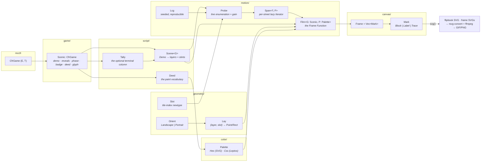

# reel

The Frame Function: one tree geometry, two orientations, many frames —
generic up to the mccfr trait hierarchy. Renders any `CfrGame`'s tree as a
scripted, deterministic animation: an authored hand explored phase by phase,
one trajectory per frame, the chosen line freezing white before the next
phase is revealed. NLHE ships in both orientations; a Kuhn reel renders from
one ~70-line `Scenic` impl — the genericity proof.



## Module layout

Every directory re-exports flat, so the public API is `reel::*` regardless of depth.

| Directory | Owns |
|---|---|
| `game/` | the mccfr seam — `Scenic`, `Atlas`, the NLHE and Kuhn impls |
| `game/chart/` | client-facing data over a game: `Range`, `Posterior`, `Verdict` |
| `script/` | the authored hand — `Demo`, `Step`, `Scene`, `Layer`, `Stint`, `Tally`, `Deed` |
| `geometry/` | (layer, slot) layout — `Lay`, `Orient`, `Brink`, `Slot` |
| `geometry/coord/` | coordinates — `Along`, `Cross`, `Axial`, `Point`, `Rect` |
| `motion/` | choreography on the reel clock — `Film`, `Span`, `Probe`, `Lcg`, `Easing` |
| `canvas/` | pure render data — `Frame`, `Mark`, `Anchor`, `Face`, `Token`, `Rune` |
| `color/` | the paint seam — `Palette`, `Hex`, `Css`, `Paint`, `Tint` |
| `panels/` | composed panels — `Panel`, `Ensemble`, `Trio`, `Curve`, `Dial`, `Sheet` |


## The unification

- **All layout happens in abstract (layer, slot) space**; `Orient` is a single
  axis swap, so the horizontal (`Landscape`) and vertical (`Portrait`) trees
  are two projections of one structure. Glyphs stay upright in both.
- **`Mark` is pure data** — renderable to SVG strings today, mountable as
  Leptos views tomorrow. Frame equality is structural, which powers the
  no-jitter dedup.
- **`Palette` is the paint seam**: `Hex` produces the standalone dark-mode
  assets; `Css` produces `var(--…)` references so the app's theme owns the
  values. Same film, two worlds.
- **Generic up to mccfr**: all game specifics enter through `Scenic`
  (`demo`/`reveals`/`phase`/`badge`/`deed`/`glyph`); menus are the REAL legal
  actions along the demo line, not authored mirrors. `Deed` is the semantic
  action vocabulary the palette speaks, so paint never sees an edge type.
  `Slot` types every tile index.
- **Major and minor ranks**: `Layer::Board` and `Layer::Settle` are the
  boundaries that open and close a phase — each drawn on a full-height
  colored band (pocket grey, felt green, terminal gold). `Layer::Choice` is
  the minor rank that lives between them, bare. Every band, caption, and
  token face goes through the same `faces()`/`caption()` pair, so a new
  major rank costs one enum arm, not a second drawing path.
- **One type per file, everywhere** — 45 modules across the directories
  above, each owning exactly one struct/enum/trait.

## The settlement column

A scene may close with a `Tally`: the seat that took the pot (actor band),
how the hand ended (phase band), and the result tiles. It is **optional** —
attached by `Demo::settled`, appended by `Scene`, painted only in the
`close()` frame. The Kuhn reel ships without one, which is the proof that
the geometry, the spine, and the canvas all measure one column shorter when
it isn't there.

Painting it only at `close()` is deliberate: during the last phase the hand
hasn't ended yet, and a gold band sitting there would spoil an outcome the
probes are still exploring.

NLHE fills it the same way the client's tree does — final pot, then what
hero walked away with: the signed net when a fold settles it, hero's made
hand when a showdown leaves villain's cards hidden. A `Witness` never holds
villain's cards, so neither surface ever invents a winner.

## Choreography invariants

Authored, not random (every "stochastic" choice is a seeded `Lcg`). Every
street lasts exactly `SPAN` frames; probes grow one edge per frame and reset
sharply; no two consecutive identical edges within a line; folds and calls
terminate a line; consecutive probes open with different first actions; the
chosen non-folding line closes each street and freezes white; later streets
stay hidden until reached; the settlement lands only on the completed hand;
only that completed hand lingers (`LINGER`).

## Usage

```bash
cargo run -p reel          # → tree_v1_{connected,transposed}.svg + tree_kuhn.svg
                           #   + docs/assets/_frames/<name>/{NNNN,still}.svg
```

Rust owns the frames; pixels are left to external tools. To rasterize a reel,
convert each staged frame with `rsvg-convert -z 2` and stitch the PNGs with
`ffmpeg -framerate 20` (a `palettegen`/`paletteuse` pass keeps the GIF small).
